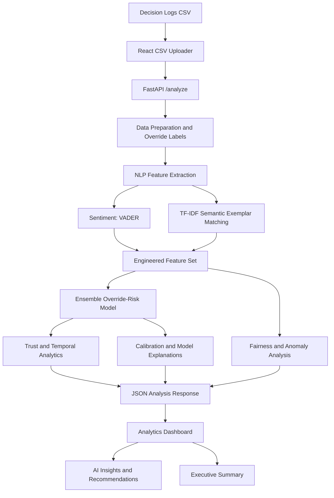
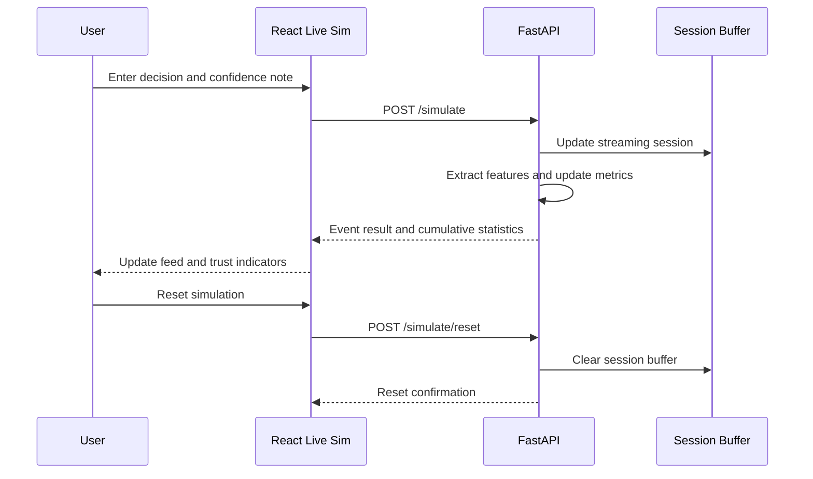

# OverWatch AI — Credit Decision Trust Intelligence


**OverWatch AI** is a human–AI trust intelligence platform for teams that use AI-assisted credit and lending decisions. It analyzes decision logs and underwriter confidence notes to surface override patterns, possible trust degradation, model-risk signals, fairness concerns, anomalies, and recommended follow-up actions.

**Live application:** https://over-watch-ai-woad.vercel.app/

> **Important:** OverWatch AI is a decision-support and governance prototype. Its scores and recommendations are advisory, not proof of model correctness, legal compliance, or creditworthiness. Do not use it as the sole basis for lending, denial, or other consequential decisions.

---

## Table of Contents

- [Why OverWatch AI?](#why-overwatch-ai)
- [The Problem It Addresses](#the-problem-it-addresses)
- [Core Capabilities](#core-capabilities)
- [How It Works](#how-it-works)
- [Architecture](#architecture)
- [Machine Learning and Analytics](#machine-learning-and-analytics)
- [Data Format](#data-format)
- [Repository Structure](#repository-structure)
- [Technology Stack](#technology-stack)
- [Run Locally](#run-locally)
- [Configuration](#configuration)
- [API Reference](#api-reference)
- [Deployment](#deployment)
- [Testing and CI](#testing-and-ci)
- [Understanding the Results](#understanding-the-results)
- [Security, Fairness, and Limitations](#security-fairness-and-limitations)
- [Troubleshooting](#troubleshooting)
- [Future Improvements](#future-improvements)
- [Contributing](#contributing)
- [License](#license)

## Why OverWatch AI?

AI systems can recommend approving or rejecting a credit application, but the recommendation alone does not reveal whether the people using the system understand it, trust it, challenge it appropriately, or follow it without sufficient scrutiny.

OverWatch AI examines the interaction between an AI recommendation and the human decision-maker. It combines structured decision logs with free-text confidence notes to help teams investigate questions such as:

- How frequently do human reviewers disagree with an AI recommendation?
- Are override rates or trust indicators changing over time?
- Do reviewer notes express uncertainty, skepticism, or possible compliance concerns?
- Are there unusual records or patterns that deserve manual inspection?
- Do model outcomes or override patterns differ across operational departments?
- What follow-up actions should a governance or risk team consider?

The goal is to make human–AI interaction patterns more observable and easier to review.

## The Problem It Addresses

Traditional model monitoring often concentrates on predictive performance. In a human-in-the-loop workflow, however, operational risk can also appear in the relationship between the model and its users.

Examples include:

1. **Repeated overrides:** a reviewer frequently disagrees with model recommendations.
2. **Unexplained acceptance:** reviewers may accept recommendations even when their notes express uncertainty.
3. **Decision fatigue signals:** very short notes may indicate low documentation effort, although note length alone cannot establish fatigue.
4. **Potential compliance flags:** notes may mention KYC, sanctions, documentation, or fair-lending concerns.
5. **Changing behavior:** override rates and trust-related measures may shift over time.
6. **Uneven patterns:** differences between departments or groups may warrant further investigation.

OverWatch AI brings these signals into one analytical workflow. The signals are indicators for investigation—not definitive diagnoses of a person, model, or institution.

## Core Capabilities

### 1. CSV-based analysis

Upload a CSV file containing AI recommendations, human decisions, dates, and reviewer notes. The frontend sends the file to the FastAPI backend for processing and displays the returned analytics.

### 2. NLP and semantic note analysis

- VADER sentiment analysis extracts sentiment polarity and negativity from confidence notes.
- A local TF-IDF n-gram matcher compares notes with exemplar phrases related to cognitive uncertainty, disputes, and compliance.
- Derived indicators include skepticism, note length, word count, and a possible rubber-stamping/low-effort marker.

### 3. Override-risk modeling

The backend derives whether the human decision differs from the model decision and trains an ensemble-style classifier using Random Forest, Gradient Boosting, and Logistic Regression components. Model outputs are used to estimate override-related risk; they should not be interpreted as universal probabilities without suitable validation and calibration.

### 4. Trust and temporal analytics

The application calculates trust-related indicators and time-based patterns, including rolling override measures, trust volatility, trust decay, alignment, and CUSUM-based change detection. Bayesian trust scoring uses a Beta–Bernoulli formulation and can report a posterior mean with a credible interval.

### 5. Drift monitoring

- **CUSUM:** flags sustained changes in a monitored time series.
- **Population Stability Index (PSI):** compares feature distributions to help identify distribution shifts.

Drift indicators do not automatically prove that a model has become inaccurate. They signal that the underlying data or process may need investigation.

### 6. Fairness monitoring

The backend computes group-oriented fairness statistics such as demographic-parity differences and disparate-impact ratios when the required group and outcome information is available. These measurements depend on the data and group definitions supplied; they are not a legal certification.

### 7. Anomaly detection

An Isolation Forest-based component identifies records that appear unusual relative to the data used for analysis. An anomaly is not necessarily an error or fraud.

### 8. Model explanations

The backend generates feature-attribution-style explanations to help identify signals associated with a prediction. These are explanatory aids, not causal explanations. The implementation includes an offline SHAP-style attribution routine rather than requiring a hosted explanation service.

### 9. Confidence-based routing suggestions

The backend produces review-routing labels such as:

- `AUTO_APPROVE`
- `STANDARD_REVIEW`
- `SENIOR_REVIEW`

These are prototype workflow suggestions. They must not be wired directly to automated credit approval or denial in a real lending environment without rigorous validation, controls, and human oversight.

### 10. Live simulation

The **Live Sim** page lets a user submit individual example decisions and observe cumulative metrics as the session develops. Preset scenarios include ordinary agreement, potential fraud/compliance flags, short-note behavior, and contextual overrides. The simulation is useful for demonstrations and exploratory testing; it is not a substitute for evaluation on representative production data.

### 11. Executive insights and recommendations

The results view brings together metric summaries, fairness indicators, anomaly results, model explanations, top risks, suggested actions, and an executive summary.

---

## How It Works

1. **Prepare the dataset.** Create a CSV using the required columns and, where available, optional ground-truth and department fields.
2. **Upload or simulate.** Upload a CSV from the main page or open **Live Sim** to submit one decision at a time.
3. **Validate and prepare data.** The backend reads the submitted records and derives override labels and analytical features.
4. **Extract text signals.** VADER and the local TF-IDF exemplar matcher process the reviewer notes.
5. **Train/score the risk model.** The backend uses the available decision records and engineered features in the override-risk modeling workflow.
6. **Compute governance metrics.** Trust, drift, calibration, fairness, anomaly, and explanation routines run where their input requirements are met.
7. **Return structured results.** FastAPI responds with JSON for the frontend.
8. **Explore results.** React components display dashboards, insights, anomaly/fairness panels, recommendations, and an executive summary.

### End-to-end workflow



### Live simulation workflow



---

## Architecture

OverWatch AI uses a separated frontend/backend architecture.

| Layer | Responsibility | Main implementation |
|---|---|---|
| Presentation | Landing page, file upload, simulation, charts and insight panels | React + TypeScript |
| UI and motion | Reusable UI primitives, notifications, transitions | shadcn-style UI components, Radix UI, Framer Motion |
| API | File upload, analysis, simulation and health routes | FastAPI |
| Data processing | CSV parsing, feature engineering and metric calculations | pandas, NumPy, SciPy |
| NLP | Sentiment and semantic exemplar similarity | NLTK VADER, scikit-learn TF-IDF |
| ML | Risk prediction, anomaly detection and supporting evaluation | scikit-learn |
| Experiment tracking | JSON and CSV records of model runs | `backend/experiment_tracker.py` |
| Hosting | Frontend and backend deployed separately | Vercel + Render |

### Main analysis modules

The analytical routines live primarily in `backend/app.py`. The current implementation includes functions for:

- `extract_nlp_features`
- `compute_calibration_metrics`
- `train_trust_model`
- `predict_with_ensemble_uncertainty`
- `compute_confidence_routing`
- `compute_shap_explanations`
- `compute_fairness_metrics`
- `compute_cusum_drift`
- `compute_psi_single_feature`
- `compute_feature_level_drift`
- `compute_bayesian_trust_score`
- `trust_volatility`
- `trust_decay_rate`
- `human_ai_alignment_index`
- `generate_recommendations`
- `detect_anomalies`
- `executive_summary`

The names describe the role of each routine; actual output availability and interpretation depend on the submitted dataset and the relevant branch of the analysis.

## Machine Learning and Analytics

### Feature engineering

The NLP feature pipeline enriches the decision records with signals such as:

| Feature | Purpose |
|---|---|
| `sentiment` | VADER compound sentiment score |
| `negativity` | VADER negative sentiment component |
| `skepticism_flag` | Rule-based indicator based on dispute similarity or negative sentiment |
| `note_length` | Note character length normalized within the current data |
| `word_count` | Word count normalized within the current data |
| `cognitive_uncertainty` | TF-IDF similarity to uncertainty-related exemplars |
| `compliance_trigger` | TF-IDF similarity to compliance-related exemplars |
| `dispute_intensity` | TF-IDF similarity to dispute-related exemplars |
| `fatigue_rubberstamp` | Indicator for notes with fewer than four words |
| `ai_proposed_approval` | Whether the model decision is `approve` |
| `dept_underwriting` | Department indicator |
| `dept_fraud` | Department indicator |
| `dept_compliance` | Department indicator |
| `skepticism_x_negativity` | Interaction between skepticism and negativity |

The matcher is local and uses TF-IDF cosine similarity against a small, predefined set of exemplar phrases. It is not a large language model and does not understand context with human-level reliability. Similarity scores can be affected by wording, domain vocabulary, language, and data quality.

### Model evaluation and calibration

The backend includes standard classification metrics such as accuracy, precision, recall, F1, and ROC-AUC, along with Brier score and calibration-error measures (ECE/MCE) where the required labels and probabilities are available.

Calibration measures whether predicted probabilities correspond to observed event frequencies. They do not by themselves prove that the model is accurate, fair, or appropriate for deployment. Always inspect sample sizes, class balance, validation methodology, and confidence intervals.

### Bayesian trust score

A Beta–Bernoulli model is used to represent uncertainty around a trust-related rate. The posterior mean and 95% credible interval provide a compact view of uncertainty under the chosen model assumptions. This score is a proxy defined by the implementation—not a direct measurement of a person's internal psychological state.

### Drift and fairness metrics

CUSUM and PSI help surface changes in behavior or feature distributions. Fairness calculations can highlight group-level differences, but conclusions depend on which group labels, outcomes, and reference groups are present. Review legal requirements and domain context with qualified experts before using these metrics for regulated decisions.

---

## Data Format

### Required columns

The uploader expects a CSV containing these columns:

| Column | Required | Description | Example |
|---|---:|---|---|
| `date` | Yes | Date of the decision | `2024-01-01` |
| `model_decision` | Yes | AI recommendation | `approve` or `reject` |
| `human_decision` | Yes | Final human decision | `approve` or `reject` |
| `confidence_note` | Yes | Reviewer reasoning or confidence note | `Income documents appear inconsistent` |

### Optional columns

| Column | Description | Example |
|---|---|---|
| `ground_truth` | Verified outcome used for evaluation when available | `approve` or `reject` |
| `department` | Operational team or desk | `Underwriting`, `Fraud`, `Compliance`, `Risk Management` |

An override is identified when `model_decision` and `human_decision` differ.

### Example CSV

Save the following as `sample_decisions.csv`:

```csv
date,model_decision,human_decision,confidence_note,ground_truth,department
2024-01-01,approve,approve,"Strong repayment history; documents are consistent",approve,Underwriting
2024-01-02,approve,reject,"Income appears overstated; payslip inconsistencies detected",reject,Fraud
2024-01-03,reject,reject,"Prior default history supports the model decision",reject,Compliance
2024-01-04,reject,approve,"Loan is fully secured; additional context supports review",approve,Underwriting
```

### Data preparation tips

- Use consistent `approve` and `reject` labels.
- Keep column names exactly as specified.
- Use ISO-style dates (`YYYY-MM-DD`) where possible.
- Quote notes containing commas or line breaks according to CSV rules.
- Remove direct identifiers and unnecessary personal information before upload.
- Do not include real applicant records in a public demo or test environment.
- Use a sufficiently large, representative dataset for meaningful evaluation. Very small samples can lead to unstable metrics or model-training errors.

---

## Repository Structure

```text
OverWatch-AI/
├── .github/
│   └── workflows/
│       └── ci.yml                 # Backend checks and frontend type check
├── backend/
│   ├── app.py                     # FastAPI routes and analytics pipeline
│   ├── experiment_tracker.py      # JSON/CSV experiment logging
│   ├── requirements.txt           # Python dependencies
│   ├── src.csv                    # Included sample/source dataset
│   └── README.md                  # Backend overview
├── public/
│   ├── favicon.png
│   ├── placeholder.svg
│   └── ts*.png                    # Static image assets
├── src/
│   ├── App.tsx                    # Main routing and page composition
│   ├── App.css
│   ├── components/
│   │   ├── CSVUploader.tsx        # CSV upload and API request
│   │   ├── AnalyticsDashboard.tsx # Primary metrics and charts
│   │   ├── AIInsightsPanel.tsx    # Explanations and risk signals
│   │   ├── ExecutiveSummary.tsx   # Summary of findings
│   │   ├── FairnessMonitor.tsx    # Fairness metrics display
│   │   ├── AnomalyDetector.tsx    # Anomaly results display
│   │   ├── RecommendationsEngine.tsx
│   │   ├── HeroSection.tsx
│   │   ├── ProductStory.tsx
│   │   ├── HowItWorks.tsx
│   │   ├── Capabilities.tsx
│   │   ├── EthicsGovernance.tsx
│   │   └── ui/                    # Reusable UI primitives
│   └── pages/
│       └── Simulate.tsx            # Live decision simulation
├── app.py                          # Root import entry point for deployment
├── index.html
├── package.json
├── package-lock.json
├── render.yaml                     # Render backend deployment blueprint
├── vite.config.ts
├── tailwind.config.ts
└── README.md
```

Some generated or configuration files may be omitted from this overview. Refer to the repository for the complete current tree.

## Technology Stack

### Frontend

- **React 18** — component-based interface
- **TypeScript** — typed frontend code
- **Vite** — development server and production bundler
- **Tailwind CSS** — utility-first styling
- **Radix UI / shadcn-style components** — accessible UI building blocks
- **Recharts** — charts and visual analytics
- **Framer Motion** — transitions and animated UI
- **React Router** — page navigation
- **TanStack React Query** — request/cache utilities
- **Papa Parse** — CSV-related browser functionality

### Backend and analytics

- **Python 3.11**
- **FastAPI** and **Uvicorn**
- **pandas** and **NumPy**
- **scikit-learn**
- **SciPy**
- **NLTK VADER**
- **python-multipart** for file upload handling
- **pytest** listed for testing

## Run Locally

### Prerequisites

Install:

- Python 3.11
- Node.js 20 or a compatible current Node.js release
- npm
- Git (optional, for cloning)

### 1. Get the code

```bash
git clone <YOUR_REPOSITORY_URL>
cd OverWatch-AI
```

If you downloaded a ZIP, extract it and open a terminal in the extracted project directory.

### 2. Set up the backend

From the repository root:

```bash
python -m venv .venv
```

Activate the environment:

**Windows PowerShell**
```powershell
.venv\Scripts\Activate.ps1
```

**Windows Command Prompt**
```bat
.venv\Scripts\activate.bat
```

**macOS / Linux**
```bash
source .venv/bin/activate
```

Install dependencies and the VADER lexicon:

```bash
python -m pip install --upgrade pip
pip install -r backend/requirements.txt
python -c "import nltk; nltk.download('vader_lexicon')"
```

Start the API from the **repository root**:

```bash
uvicorn backend.app:app --reload --host 127.0.0.1 --port 8000
```

The API should be available at `http://127.0.0.1:8000`. FastAPI's interactive documentation is usually available at `http://127.0.0.1:8000/docs`.

> Starting from the repository root using `uvicorn backend.app:app` ensures imports match the deployment configuration. The backend README's `uvicorn app:app` command is intended for running from inside the `backend` directory.

### 3. Set up the frontend

Open a second terminal in the repository root:

```bash
npm ci
```

If npm reports a peer-dependency resolution issue, try the repository CI command:

```bash
npm ci --legacy-peer-deps
```

Create `.env.local` in the root directory:

```env
VITE_API_URL=http://127.0.0.1:8000/analyze
```

Run the development server:

```bash
npm run dev
```

Open the local URL printed by Vite (commonly `http://localhost:5173`).

### 4. Try the application

1. Open the main page.
2. Navigate to the upload section.
3. Use a CSV that follows the [data format](#data-format).
4. Review the dashboard, fairness and anomaly panels, insights, recommendations, and executive summary.
5. Open **Live Sim** to submit sample decision events.
6. Use the reset action to clear the current simulation session.

### 5. Build the frontend

```bash
npm run build
npm run preview
```

Other available scripts:

```bash
npm run lint
npm run build:dev
```

---

## Configuration

### Frontend environment variables

| Variable | Purpose | Example |
|---|---|---|
| `VITE_API_URL` | Backend analysis endpoint used by the frontend | `http://127.0.0.1:8000/analyze` |

The simulation page derives its base API URL by removing `/analyze` from `VITE_API_URL`. Therefore, configure this variable with the full `/analyze` endpoint, not only the server root.

For a deployed frontend, use the full public backend URL, for example:

```env
VITE_API_URL=https://YOUR-BACKEND-DOMAIN/analyze
```

### Backend environment variables

| Variable | Purpose |
|---|---|
| `FRONTEND_URL` | Frontend origin allowed by CORS in the backend |
| `HF_TOKEN` | Optional deployment secret declared in the Render blueprint; configure only if a connected feature requires it |

Keep secrets in your hosting provider's environment settings. Do not commit `.env` files, API keys, tokens, credentials, or real applicant data.

**CORS note:** the current backend code falls back to allowing all origins when `FRONTEND_URL` is not set. For production, explicitly configure the expected frontend origin and review the CORS policy before exposing the API publicly.

---

## API Reference

The backend is implemented with FastAPI. Request and response schemas can be inspected at `/docs` while the server is running.

| Method | Endpoint | Purpose |
|---|---|---|
| `GET` | `/` | Basic service/root response |
| `GET` | `/api/health` | Health check |
| `POST` | `/analyze` | Accepts a CSV upload and returns the analysis result |
| `POST` | `/simulate` | Processes one simulated decision event and updates session metrics |
| `POST` | `/simulate/reset` | Clears the simulation session buffer |

### `POST /analyze`

- **Content type:** `multipart/form-data`
- **Form field:** `file` — CSV file
- **Purpose:** executes the analysis pipeline and returns a JSON object consumed by the results UI.

The frontend currently reads result properties including `metrics`, `advanced_analysis`, `ground_truth_metrics`, `fairness_metrics`, `anomalies`, `ml_weights`, `rag_explanations`, `top_risks`, `recommendations`, and `executive_summary` when supplied by the backend.

### `POST /simulate`

Accepts a JSON decision event. The Live Sim interface sends fields in this general form:

```json
{
  "model_decision": "approve",
  "human_decision": "reject",
  "confidence_note": "Income documentation appears inconsistent",
  "department": "Fraud"
}
```

The endpoint returns the event-level result and cumulative session statistics used to refresh the live feed. Refer to `/docs` and `src/pages/Simulate.tsx` for the precise response fields in the current version.

### `POST /simulate/reset`

Resets the active in-memory simulation session. Since this is an in-memory buffer, behavior across multiple workers or instances depends on deployment topology; it is not a persistent multi-user session store.

### `GET /api/health`

Use this endpoint to check whether the backend service is responding. A successful health response does not guarantee that every model pipeline or frontend integration is working.

---

## Deployment

The repository is configured for a split deployment:

- **Frontend:** Vercel
- **Backend:** Render

### Backend on Render

The `render.yaml` blueprint defines a Python web service with Python 3.11, installs `backend/requirements.txt`, downloads the NLTK VADER lexicon, and starts the service with Uvicorn.

1. Push the repository to a Git provider.
2. Create or update a Render service using the repository blueprint.
3. Confirm the service's branch matches the branch containing the project.
4. Set `FRONTEND_URL` to the deployed frontend's origin, without an unnecessary trailing slash.
5. Add `HF_TOKEN` only if required by the deployment's enabled functionality.
6. Deploy and verify `/api/health` and `/docs`.

The blueprint currently specifies `branch: main`; change it if your default branch has a different name.

### Frontend on Vercel

1. Import the repository into Vercel.
2. Use the repository root as the project root.
3. Set the build command to `npm run build` if it is not detected automatically.
4. Set `VITE_API_URL` to the deployed backend's full `/analyze` URL.
5. Deploy and test both CSV upload and Live Sim.

### Deployment checklist

- [ ] Backend is reachable over HTTPS.
- [ ] `VITE_API_URL` points to the correct `/analyze` endpoint.
- [ ] `FRONTEND_URL` matches the deployed frontend origin.
- [ ] NLTK VADER data is available in the runtime.
- [ ] A small synthetic CSV completes successfully.
- [ ] Live simulation and reset work against the deployed backend.
- [ ] Logs contain no secrets or personal applicant data.
- [ ] Production data access, retention, and authentication policies have been reviewed.

---

## Testing and CI

The GitHub Actions workflow at `.github/workflows/ci.yml` runs on pushes and pull requests targeting `main` or `master`.

The current workflow includes:

1. Setting up Python 3.11.
2. Installing backend dependencies.
3. Downloading the NLTK VADER lexicon.
4. Compiling the backend Python files to catch syntax errors.
5. Verifying core Python dependency imports.
6. Setting up Node.js 20.
7. Installing frontend dependencies with `npm ci --legacy-peer-deps`.
8. Running `npx tsc --noEmit` for TypeScript checks.

Run equivalent checks locally:

```bash
python -m py_compile backend/app.py
python -m py_compile backend/experiment_tracker.py
npx tsc --noEmit
npm run lint
npm run build
```

Although `pytest` is included in the backend dependencies, a comprehensive automated test suite is not documented here. Add unit tests for feature extraction, metric calculations, malformed uploads, class imbalance, missing columns, and simulation-session behavior before treating the project as production-ready.

---

## Understanding the Results

| Output | How to interpret it | What not to conclude |
|---|---|---|
| Override rate | Frequency of disagreement between AI and human decisions | That either side is necessarily correct |
| Sentiment / skepticism | Language signals in reviewer notes | A definitive measure of a person's trust or intent |
| Trust posterior | A model-based summary of a defined trust-related rate | A direct psychological measurement |
| CUSUM alert | Potential sustained shift in a monitored sequence | Confirmed model drift or performance degradation |
| PSI | Difference between feature distributions | Proof that model predictions are invalid |
| Fairness metrics | Group-level outcome differences under selected definitions | Legal compliance or absence of discrimination |
| Anomaly score | A record differs from learned patterns | Fraud, misconduct, or a data error |
| Feature attribution | Features associated with a model output | Causation or a complete explanation |
| Review route | Suggested level of additional review | Authorization to approve or reject a loan |

Metrics should be interpreted together with sample size, data provenance, model validation, domain expertise, and the operational context.

## Security, Fairness, and Limitations

OverWatch AI is a prototype for analytics and governance support. Before adapting it to real lending workflows, address at least the following:

- **Sensitive data:** minimize and de-identify uploaded data; define access control, retention, deletion, and audit policies.
- **Authentication:** add authentication and authorization before making analysis endpoints available to multiple users.
- **Upload safety:** enforce file-size limits, row limits, column validation, encoding handling, and defensive parsing.
- **CORS:** replace permissive development defaults with an explicit allowlist in production.
- **Session isolation:** replace the in-memory simulation buffer with per-user session state if concurrent users are supported.
- **Reproducibility:** record dataset versions, preprocessing choices, model parameters, random seeds, and validation splits.
- **Model validation:** evaluate on representative held-out data; test for leakage, imbalance, calibration, robustness, and subgroup performance.
- **Fair lending review:** involve qualified legal, compliance, and domain experts. A dashboard cannot establish ECOA/FCRA compliance on its own.
- **Human oversight:** preserve meaningful review and appeal mechanisms. Do not treat routing labels as automatic lending decisions.
- **Interpretability:** document what each metric means, how thresholds were chosen, and when a metric should be considered unavailable.
- **Operational resilience:** configure logging, monitoring, rate limits, timeouts, resource limits, and appropriate error handling.

### Known conceptual limitations

- VADER and TF-IDF exemplar matching are heuristic text-analysis techniques and may misread domain-specific language, sarcasm, abbreviations, or unfamiliar phrasing.
- The low-word-count marker is only a proxy; short notes can be legitimate and detailed notes can still be poor.
- Fairness statistics can be misleading when sample sizes are small or group/outcome fields are missing.
- Trust metrics are operational proxies, not direct observations of human psychology.
- A model trained on a small or synthetic dataset may appear to perform well without generalizing to real-world data.
- Calibration and evaluation metrics are only meaningful when labels, splits, and probability estimates are appropriate.
- This README describes the current repository structure and intended behavior; inspect the implementation before relying on any metric in a consequential setting.

## Troubleshooting

### Frontend cannot connect to the backend

- Confirm Uvicorn is running on port `8000`.
- Check that `.env.local` contains the full `/analyze` URL.
- Restart Vite after changing environment variables.
- Check browser developer tools for network and CORS errors.
- Confirm `FRONTEND_URL` is set correctly on Render.

### NLTK VADER lexicon error

Run:

```bash
python -c "import nltk; nltk.download('vader_lexicon')"
```

Then restart the backend.

### CSV upload fails

- Confirm the file extension is `.csv`.
- Verify all four required column names are present.
- Check that decisions use the expected `approve` / `reject` labels.
- Inspect the backend terminal for the exception details.
- Try the sample CSV with synthetic data to separate formatting issues from environment issues.

### Frontend dependency installation fails

Try:

```bash
npm ci --legacy-peer-deps
```

Use the lockfile committed with the repository, and avoid mixing package managers without intentionally regenerating the lockfile.

### Build or type check fails

```bash
npx tsc --noEmit
npm run lint
npm run build
```

Fix the first reported error and rerun the checks. A successful frontend build does not guarantee that the deployed backend URL or API response shape is correct.

---

## Future Improvements

Potential next steps include:

1. Add a validated, versioned sample dataset and a downloadable CSV template.
2. Add automated tests for each analytics function and API endpoint.
3. Separate training from inference and evaluate on a strict held-out dataset.
4. Add model and dataset versioning with reproducible experiment records.
5. Improve schema validation and user-friendly error messages for uploaded CSVs.
6. Add authenticated accounts, role-based access, and isolated analysis sessions.
7. Add configurable drift thresholds and explain why each alert was raised.
8. Expand fairness evaluation with documented group definitions, uncertainty intervals, and small-sample warnings.
9. Add data export and audit reports that record methodology and limitations.
10. Add accessibility checks and end-to-end frontend tests.
11. Support persistent, multi-user simulation sessions rather than a single in-memory buffer.
12. Add privacy-conscious data retention and deletion controls.

## Contributing

Contributions and issue reports are welcome.

1. Fork the repository.
2. Create a focused branch for your change.
3. Keep analytical functions testable and document any assumptions.
4. Run the backend syntax checks, frontend type check, lint, and build.
5. Open a pull request describing the change, its motivation, test evidence, and any effect on metric interpretation.

For changes to fairness, risk, or trust calculations, include examples and explain the assumptions behind thresholds and formulas.

## License

The project README declares the **MIT License**. Ensure a `LICENSE` file is present in the repository and matches that declaration before redistributing the project.

---

<p align="center">
  <strong>OverWatch AI</strong><br/>
  Making human–AI decision patterns more visible, explainable, and reviewable.
</p>
